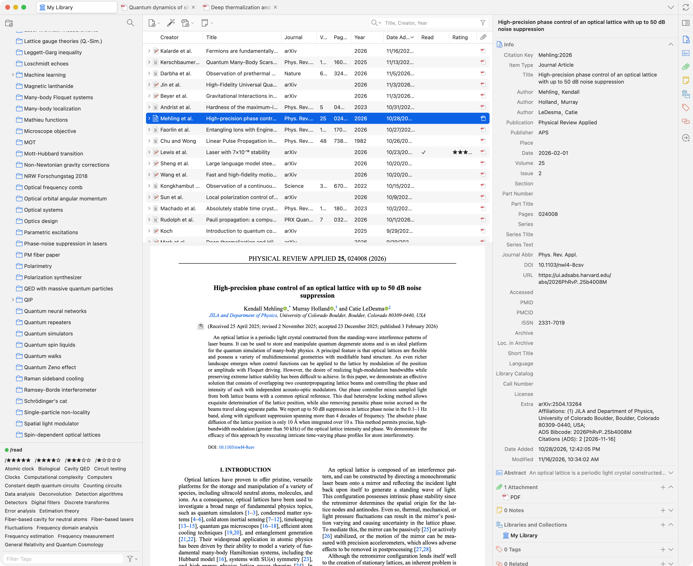

# PDF Preview Pane for Zotero

A Zotero plugin that shows the selected item's PDF in a pane below the item list, with continuous scrolling and fit-to-width. Moving through the item list with ↑ and ↓ changes the PDF shown, as in a mail client.

Zotero's own preview, in the Attachments section of the item pane, shows one page at a time and is as wide as the item pane.



## Use

- The pane shows the PDF of the selected item: the item itself if it is a PDF attachment, otherwise its main attachment.
- Scroll with the trackpad or mouse wheel over the pane.
- Drag the splitter above the pane to change its height. Zotero keeps the height.
- Double-click the PDF to open it in a reader tab, at the page shown.
- View → Layout → PDF Preview Pane, or ⇧⌘P (Ctrl+Shift+P on Linux and Windows), shows or hides the pane.

You cannot select text in the pane: Zotero's preview reader draws no text layer.

## Install

1. Download `zotero-pdf-preview-pane-<version>.xpi` from the [latest release](https://github.com/alberti42/zotero-pdf-preview-pane/releases/latest), or run `./build.sh`, which writes it to `build/`.
2. In Zotero, open Tools → Plugins, click the gear icon, choose "Install Plugin From File…" and pick the `.xpi`.

Zotero checks `updates.json` in this repository for new versions. `CHANGELOG.md` lists the changes in each version.

From version 0.1.2, GitHub Actions builds the `.xpi` of each release and attests its build provenance. To check that a downloaded `.xpi` was built by this repository's workflow, run:

```
gh attestation verify zotero-pdf-preview-pane-<version>.xpi --repo alberti42/zotero-pdf-preview-pane
```

`build.sh` is reproducible: building the release's tag gives a file with the same SHA-256.

## Privacy and security

The plugin collects no information and sends nothing anywhere. [SECURITY.md](SECURITY.md) lists what it reads and stores, and how to report a security problem privately.

## Requirements

Zotero 7 to 10. The plugin was tested on Zotero 10.0.9 on macOS. It contains no code specific to macOS.

## How it works

The pane uses Zotero's `ReaderPreview` (`chrome/content/zotero/xpcom/reader.js` in Zotero's `omni.ja`), the reader behind the preview in the Attachments section. `ReaderPreview` holds that preview to one page with the CSS rule `#viewerContainer { overflow: hidden }` and with `scrollMode = 3` (one page at a time) and scale `page-height`; the plugin overrides both. `ReaderPreview` is not part of Zotero's plugin API, so a major Zotero update can break the plugin.
